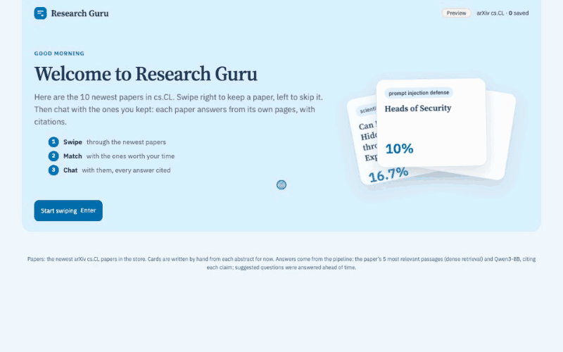
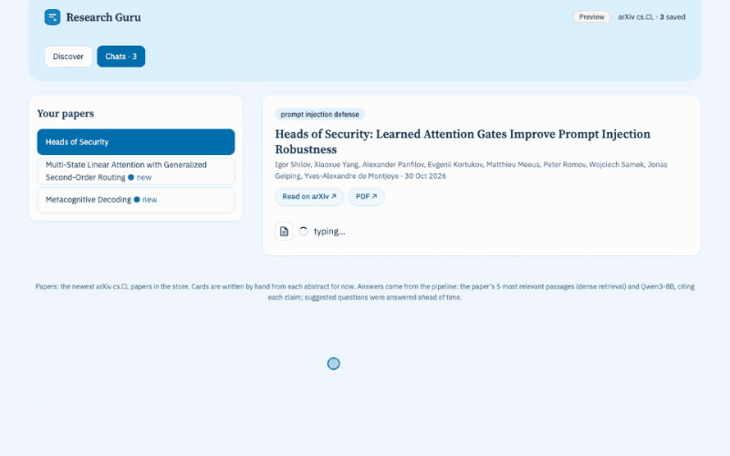
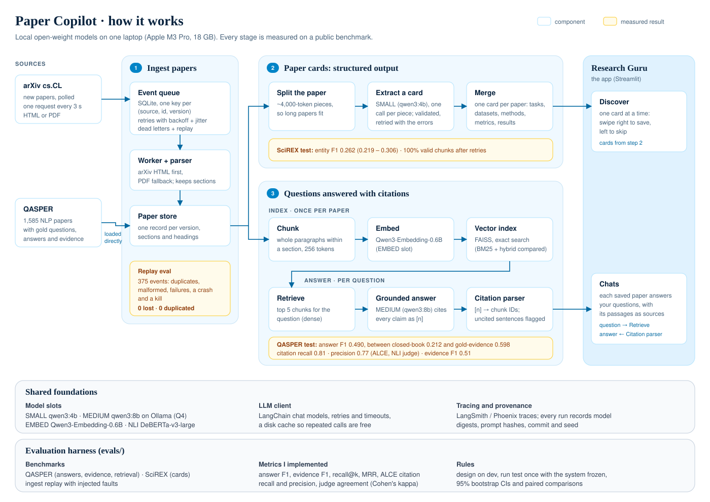

# Research Guru

**Tinder for research papers.** Every morning, swipe through the newest NLP papers: right to keep one, left to skip it. Then chat with the papers you kept. Each answer comes from the paper's own text and cites the passages it used.

It runs entirely on local open-weight models (Qwen3 4B and 8B on a laptop), and every component is measured on a public benchmark.

**Swipe** through the newest papers and keep the ones worth your time:

<p align="center"></p>

**Chat** with a paper you kept. Answers cite the passages they come from, and the paper itself is one click away:

<p align="center"></p>

<p align="center"><a href="https://github.com/NishantSushmakar/paper-copilot/blob/master/docs/demo.webm"><b>▶ Watch the full 1-minute demo</b></a></p>

> The demo app (`ui/demo.py`) runs on the 10 newest arXiv cs.CL papers in the paper store. The answers come from the real pipeline, and every cited passage links back to the paper. The cards are written by hand from each abstract for now, until model-extracted cards are ready.

## How it works



**1. Ingest papers.** A poller watches arXiv cs.CL and turns each new paper or new version into an event in a SQLite queue. A worker downloads the paper (HTML first, PDF as the fallback), parses it into sections and stores one record per version.
- Each event has an idempotency key, (source, id, version), so a duplicate event is ignored.
- A failed event is retried with exponential backoff and jitter. After the last attempt it moves to a dead-letter table, where it can be inspected and replayed.
- A replay test sends 375 events with duplicates, malformed payloads, transient failures, a crash and a kill: **0 events lost, 0 processed twice.**

**2. Paper cards.** Each paper becomes a structured card: its tasks, datasets, methods, metrics and reported results.
- Papers are longer than the model's context, so the paper is split into pieces of about 4,000 tokens.
- The small model (Qwen3 4B) extracts a card from each piece. Pydantic validates it, and an invalid card goes back to the model with the errors.
- The piece cards are merged into one card per paper. These cards are what you swipe through.
- **On SciREX, the extractor scores an entity F1 of 0.262.**

**3. Questions answered with citations.** When you ask a saved paper a question:
- The paper is split into chunks of whole paragraphs within a section, up to 256 tokens each, and embedded with Qwen3-Embedding-0.6B.
- The 5 chunks closest to the question are retrieved (dense retrieval, FAISS).
- The 8B model writes an answer that must cite a numbered passage, [1] to [5], for every claim.
- A parser maps each [n] back to its chunk and flags any sentence without a citation. The chat shows the cited passages as sources.

**Underneath** sits a model layer that addresses models by role, not by name:
- the roles: SMALL, MEDIUM, EMBED and an NLI model;
- a disk cache, so a repeated call costs nothing;
- tracing in LangSmith or Phoenix;
- provenance on every run: model digests, prompt hashes, the commit and the seed.

## Results

Design choices were made on dev sets. Each test number comes from a single run with the system frozen. Every interval is a 95% bootstrap CI.

| Component | Benchmark | Result |
|---|---|---|
| Ingest pipeline | Replay of 375 events with injected faults | 0 lost, 0 duplicated; all 15 malformed events rejected |
| Paper cards | SciREX, 66 papers | Entity F1 **0.262** (0.219 – 0.306); 100% of pieces valid after retries |
| Retrieval | QASPER dev, 185 questions | Gold evidence in the top 5: **0.623** dense vs 0.466 BM25 (paired +0.157, CI +0.085 to +0.232) |
| Answers | QASPER test, 200 questions | Answer F1 **0.490** (0.439 – 0.542). Without retrieval: 0.212. With the gold evidence paragraphs: 0.598 |
| Citations | QASPER test, 159 answers | Citation recall **0.809**, precision **0.774** (ALCE definitions, NLI judge) |
| Evidence | QASPER test | Evidence F1 **0.506** (0.453 – 0.558) |

**Findings:**
- **Dense retrieval wins on finding evidence,** and its lead comes from extractive and abstractive questions. On yes/no questions no retriever is separable. Hybrid (BM25 + dense, reciprocal rank fusion) didn't beat dense alone.
- **Paragraph-aware chunks beat fixed token windows.** Dense recall@5 is 0.623 against 0.542, and they cover the evidence with fewer tokens.
- **Most of the remaining gap is reading, not retrieval.** On dev, of the gap to the gold-evidence ceiling, about 53% comes from questions where the right passage was retrieved and the model still answered worse, and 38% from questions where retrieval missed it.
- **Passage order doesn't matter at 5 passages.** On dev, shuffling them changed mean F1 by −0.010 (CI −0.046 to +0.026).
- **The citation judge is lenient.** On 54 labelled pairs, it passed most of the unsupported sentences, so the citation scores above are upper estimates.

The full lab notebooks, with every decision, measurement and dead end, are in [`reports/`](reports/).

## Run it

You need [uv](https://docs.astral.sh/uv/) and [Ollama](https://ollama.com).

```bash
uv sync

# Models (Q4 quantised)
ollama pull qwen3:4b-q4_K_M
ollama pull qwen3:8b
OLLAMA_CONTEXT_LENGTH=8192 OLLAMA_KEEP_ALIVE=30m OLLAMA_FLASH_ATTENTION=1 OLLAMA_KV_CACHE_TYPE=q8_0 ollama serve

# The demo app (suggested answers are pre-computed; other questions need Ollama)
uv run --with streamlit streamlit run ui/demo.py
uv run python -m ui.build_demo_answers                    # re-compute the suggested answers
uv run --with playwright python scripts/record_demo.py docs/demo.webm   # re-record the video
uv run --with playwright --with pillow python scripts/demo_gifs.py docs/demo.webm   # and the GIFs

# Data for the evals
uv run python scripts/download_qasper.py
uv run python scripts/download_scirex.py

# An eval run, e.g. retrieval + grounded answers on the QASPER dev set
uv run python -m evals.run --task qasper --system rag_dense_k5 --subset dev

# Tests
uv run pytest
```

Model choices live in [`configs/models.yaml`](configs/models.yaml), and ingestion settings in [`configs/ingest.yaml`](configs/ingest.yaml). Optional tracing: `docker compose up -d` starts Phoenix on http://localhost:6006.

## Repository layout

```
copilot/
  ingest/      arXiv poller, event queue, worker, parser, paper model
  cards/       paper-card schema, extraction, merge, backfill
  retrieval/   chunking, BM25, dense (FAISS), hybrid fusion
  answer/      grounded answers and citation parsing
  llm/         model roles and the LLM client
  infra/       config, cache, tracing, provenance
evals/         benchmark adapters, metrics, runners, frozen subsets, results
ui/            Research Guru (Streamlit): demo.py, the card browser app.py
configs/       model and ingestion settings
docs/          architecture diagram and screenshots
reports/       lab notebooks
tests/
```

## What's next

- tools and an agent that plans multi-step research;
- memory of what you care about;
- knowing when to abstain, and asking before risky actions;
- routing easy questions to the small model;
- verifying scientific claims;
- wiring the real cards and cited answers into the app.
